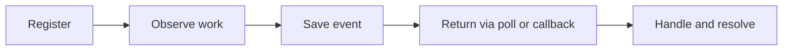
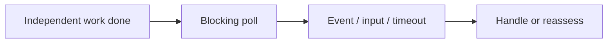
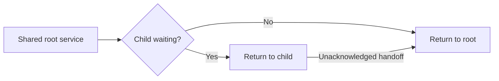
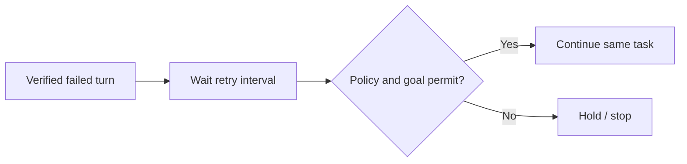

# Codex Monitor

A Node.js plugin that watches external work and wakes the same Codex conversation
when an event needs attention. The agent can continue independent work or wait
for a callback instead of repeatedly checking logs.

Supports command completion and output matching, file/directory changes, process
exit, training inactivity and NVIDIA GPU utilization. It also provides authorized
CLI waits that keep goals active, authorized goal pause/resume and bounded
recovery after conversation errors. No Codex source build, Python runtime or
separate model API key is required.

Subagents share root-owned monitoring with scoped operations and event handoff.
Remote Linux monitoring uses persistent SSH and read-only queries, without
remote Node/Python, plugin deployment or a background service.

## Latest release: v0.4.2

- Skill guidance is about **66% shorter**; MCP-wide instructions are **82% shorter**.
- Tool descriptions plus repeated shared guidance are **75% shorter** in the
  inspected Codex host. These are character counts, not model-token savings.
- All eight tools, API defaults and monitoring behavior remain compatible with
  v0.4.1. Installation preferences and recovery opt-outs are preserved.

[Download ZIP](https://github.com/EthenJ/codex-monitor/releases/download/v0.4.2/codex-monitor-v0.4.2.zip)
· [SHA-256](https://github.com/EthenJ/codex-monitor/releases/download/v0.4.2/codex-monitor-v0.4.2.zip.sha256)
· [Release notes](https://github.com/EthenJ/codex-monitor/releases/tag/v0.4.2)

## How it works

1. Codex registers a finite observer through the plugin's typed MCP tools.
   Configuration and local prerequisites are validated before observation starts.
2. A background Node.js service watches the workload. Healthy progress and local
   sensor sampling do not invoke the model.
3. Relevant events are saved. During a blocking wait they return through the
   pending MCP call; otherwise the existing local Codex daemon delivers native
   tool outputs to the original conversation.
4. The agent inspects the evidence, performs the registered action and
   acknowledges the event. Trusted Stop/Interrupt hooks report a concise running
   count when the turn ends, without a separate agent reporting call.



When only monitored work remains, `poll` (shown as `monitor.poll` in CLI)
keeps one tool call pending while the goal stays active. A monitor event, timeout
or new CLI input releases it. Input detection requires readable history under
the same `CODEX_HOME`; it samples locally, leaving message text with Codex.
This adapter does not establish desktop support, and blocking may still count
toward goal elapsed time.

An omitted timeout uses one hour; a supplied valid value takes precedence.
Cancellation, goal changes and connection loss also release the call and require
reconciliation before rearming.

Explicit `mode: "pause"` retains authorized native pause/resume waiting. It
confirms the pause and holds early events until the current turn has ended.
Manually resuming the same live paused goal preserves its monitors. Manual
pauses, task/budget edits and interruptions take precedence in both modes.

Native callbacks require the same loaded local Codex daemon. CLI output is text;
graphical panels depend on client support.

Subagents pass their own `thread_id`. The plugin verifies their ancestry and
registers observers under the root task while retaining their creator. The root
can inspect the whole task; children can operate only their own branches.
Independent child polls can run alongside a root poll. Only the root controls
shared recovery and optional native goal pause/resume.

Child completion or closure preserves root-owned observation. Unacknowledged
results handed back to the root require reconciliation before further action.
Native agent messages and new CLI input from verified ancestors release pending
child waits without replaying message text. Manual parent pause/interruption
takes precedence. See [subagent behavior](codex-monitor/references/plugin.md#subagents)
for compatibility, ownership and upgrade details.

<details>
<summary>CLI waiting, subagent delivery and recovery flows</summary>

**CLI waiting.** One pending call returns evidence, releases for new input or
returns once on timeout. It does not start an agent polling loop.



**Subagents.** Verified branches share one service. Unacknowledged child results
go to the root for reconciliation; child completion preserves observation.



**Recovery.** The installation policy controls first-use activation. Stops,
limits and uncertain submissions prevent automatic retries.



</details>

## Installation

Requires Node.js **22.22+** (24 recommended), npm, Codex CLI **0.166.0+** and a
compatible local Codex daemon. Windows native tests use Codex 0.167.0; the Ubuntu
container suite also checks compatibility with 0.166.0.
GPU monitoring additionally requires working `nvidia-smi`.

Download and extract the [v0.4.2 package](https://github.com/EthenJ/codex-monitor/releases/tag/v0.4.2),
or clone the repository. Run from its directory in a normal terminal:

```sh
node install.mjs
```

The wizard asks for the Codex configuration directory, client, compact/verbose
output, automatic hook reports, background launcher startup and default recovery
(on: retry abnormal failures every 300 seconds for up to 3 hours). It shows the
plan before installing. Use `node install.mjs --dry-run` to preview it.

After installation:

1. Fully exit and reopen Codex. Check the plugin in `/plugins` and its connection
   in `/mcp`; ask Codex to call `display` to verify execution.
2. If automatic reports were included, review and trust this plugin's Stop and
   Interrupt hooks in `/hooks`. An upgrade may require reviewing them again.
3. If the launcher was not started, run the command printed by setup from an
   external terminal. Start it again after login/reboot; no OS service is installed.

Before upgrading, reconcile active monitors, waits, recovery and unresolved
events. The installer refuses to replace a busy installation. See the
[installation guide](codex-monitor/references/installation.md) for upgrades,
custom directories and noninteractive setup.

## Configuration

For a remote workload, use an existing SSH alias through
`transport: {type: "ssh", host: "gpu-box"}`. Remote paths/PIDs are interpreted
on that Linux host. Each root task and its subagents share one connection per SSH profile;
stopping one subscription preserves the others and never kills an observed PID.
Only existing workloads are observed: remote command launch is not supported.
The shell adapter requires compatible `sh`, `timeout`, `base64` and the selected
query utilities; GPU rules additionally need `nvidia-smi`. `validate` probes the
requested capabilities without installing packages.

Connection incidents are grouped by creator and compatible notification lifetime.
The plugin reconnects with bounded backoff; it does not restart training.
Disconnected monitors show as reconnecting,
with workload health unknown. Snapshot sampling can miss changes between reads,
and observation gaps reset continuous stall/dwell timing. Prefer explicit metrics
files over large directory scans. See [SSH monitoring](codex-monitor/references/plugin.md#ssh-monitoring).

Describe the workload and desired action to Codex, for example:

> Monitor this training process and its metrics file for 24 hours. Alert if
> progress stops for five minutes and GPU utilization stays below 10% for two
> minutes. Continue other work; when only training remains, wait in the CLI
> without pausing the goal and respond to my additional input. Do not enable
> conversation retries.

Configuration uses MCP tools with validated types and ranges. The agent supplies
the exact current `thread_id`; `options.cwd` must be an absolute workload directory.

| Setting | Tool / field | Default |
| --- | --- | --- |
| Display | `display`: `mode` | `compact`; use `verbose` for diagnostics |
| Waiting | `poll`: `mode` | `blocking` for CLI; `pause` for authorized native pause/resume |
| Wait deadline | `poll`: `timeout_ms` | 1 hour (3,600,000 ms); maximum 24 hours |
| CLI input sampling | `poll`: `input_poll_ms` | 250 ms in the background; range 50–5,000 ms |
| Observer lifetime | `start`: `options.timeout_ms` | 30 minutes; watchdog maximum 7 days, owned command maximum 30 minutes |
| File progress | `options.watch_file` or `options.watch_directory`, `options.stalled_for_ms` | Inactivity rule requires an explicit duration |
| GPU health | `options.gpu_util_below`, `options.gpu_below_for_ms`, `options.gpu_id` | Off until a threshold is set; default dwell 2 minutes, GPU `0` |
| Retry interval | `recovery`: `retry_interval_ms` | Fixed 300,000 ms (5 minutes) |
| Retry incident limit | `recovery`: `max_elapsed_ms` | 10,800,000 ms (3 hours) |
| Recovery lifetime | `recovery`: `lifetime_ms` | 86,400,000 ms (24 hours) |

For training, use `options.watchdog_only: true` to keep healthy progress quiet, with
`process_exit`, `watchdog_stalled`, `monitor_error` and `monitor_expired` notifications.
Choose `options.dead_if: "all"` to require both configured file and GPU stall conditions,
or `"any"` to alert on either. Set a lifetime that covers the expected run.

Recovery is **enabled by default** on first monitor/wait use in a root task,
using `all_failed` and the limits above. It waits for Codex's own retries to finish and only
retries verified failed turns. Manual interruption, paused goals and host
budget/usage limits prevent recovery. Disable it for the task with
`recovery(enabled: false)`, or select `recovery: false` during setup for
new tasks. Explicit opt-outs, stopped policies and service restarts are never
silently re-enabled by another monitor operation. Custom policies remain
configurable; `transient` narrows eligibility to recognized connection/server
failures.

Retries resume the conversation and require reconciling effects before repeating
work. Uncertain submissions stop automatic retries.

The eight tools are `start`, `stop`, `event`, `status`, `validate`, `display`,
`poll` and `recovery`, under the `monitor` namespace. Use `validate` to preview
configuration, `event` to inspect and resolve events, and `status` for a read-only
summary. Request `details: "active"` for the active list or supply `monitor_id`
for full observer evidence. Routine end-of-turn summaries come from trusted
hooks. `stop(target: "wait")` ends waiting and mutes its selected notifications,
preserving observers and the goal; `stop(monitor_id: ...)` stops the observer and
releases its dependent wait. Stopping a command monitor terminates its owned
process tree; a watchdog never kills the PID it observes.
Capacity warns at 24 occupied slots, with a hard limit
of 32; reconcile obsolete or compatible overlapping observers before adding more.
The CLI controls argument display and hook rendering. State is stored in
`<CODEX_HOME>/monitor-node` (normally `~/.codex/monitor-node`), or
`CODEX_MONITOR_HOME` when set. Use consistent directories for Codex and the launcher.

See the [tool and configuration reference](codex-monitor/references/plugin.md)
for complete examples, GPU rules, goal waiting and recovery policies.

## Source and validation

`main` and release ZIPs contain deployment files. TypeScript source, tests,
workflows and review records are maintained on
[`develop`](https://github.com/EthenJ/codex-monitor/tree/develop).

v0.4.2 local Windows validation: **325 passed, 18 skipped, 0 failed**, including
isolated native Codex fixtures. Production dependency installation and a fresh
MCP connection verified all eight tools, display execution, status and the UI
resource. See the
[validation record](https://github.com/EthenJ/codex-monitor/blob/develop/docs/design/v0.4.2-validation.md)
for measurements, environment gates and validation boundaries.

## License

[MIT](LICENSE).
