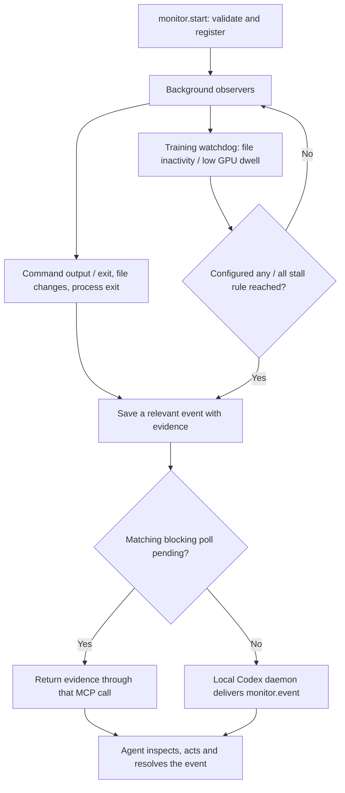
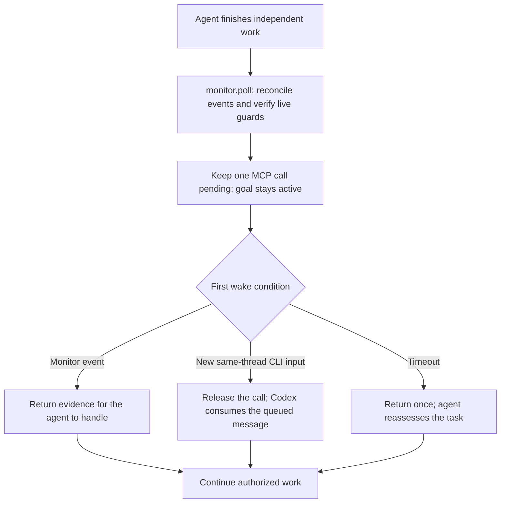
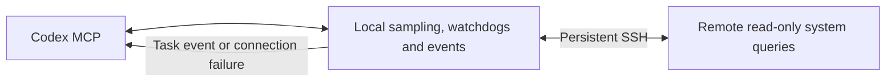
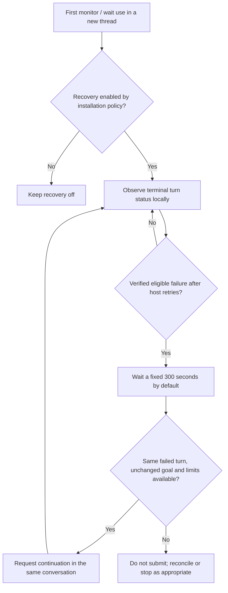

# Codex Monitor

A Node.js plugin that watches external work and wakes the same Codex conversation
when an event needs attention. The agent can continue independent work or wait
for a callback instead of repeatedly checking logs.

Supports command completion and output matching, file/directory changes, process
exit, training inactivity and NVIDIA GPU utilization. It also provides authorized
CLI waits that keep goals active, authorized goal pause/resume and bounded
recovery after conversation errors. No Codex source
build, Python runtime or separate model API key is required.

v0.4.0 adds remote Linux monitoring over a persistent SSH session. The local
plugin schedules read-only file, process and GPU queries and evaluates watchdog
rules. Remote Node/Python, plugin deployment and a background service are not
required. Connection loss is an event and bounded reconnect restores observation.

## How it works

1. Codex registers a finite observer through the plugin's typed MCP tools.
   Configuration and local prerequisites are validated before observation starts.
2. A background Node.js service watches the workload. Healthy progress and local
   sensor sampling do not invoke the model.
3. Relevant events are saved. During a blocking wait they return through the
   pending MCP call; otherwise the existing local Codex daemon delivers native
   tool outputs to the original conversation.
4. The agent inspects the evidence, performs the registered action and
   acknowledges the event. Trusted Stop/Interrupt hooks report a concise running
   count when the turn ends, without a separate agent reporting call.



Healthy sensor samples stay in the background. Training stall alerts use the
configured inactivity durations and GPU dwell thresholds; PID exit, sensor
errors and observer expiry provide separate failure signals. Delivery also
respects manual interruption, paused goals and unresolved prior results.

When only monitored work remains, `poll` (shown as `monitor.poll` in CLI)
defaults to a blocking wait.
The goal stays active and the tool remains pending without repeated model calls.
A monitor event, finite timeout or newly submitted CLI input releases it. The
plugin samples newly appended input-history records for the exact conversation
locally (250 ms by default); message text stays with Codex. This CLI adapter
requires readable input history under the same `CODEX_HOME` and does not establish
desktop-client support. Blocking may still count toward goal elapsed time.



The timeout is one hour when omitted; a supplied valid timeout takes precedence.
Input sampling runs locally without model turns. Manual cancellation, goal
changes or connection loss also release the call; these paths require
reconciliation rather than silently restarting an interrupted wait.

Explicit `mode: "pause"` retains authorized native pause/resume waiting. It
confirms the pause and holds early events until the current turn has ended.
Manually resuming the same live paused goal preserves its monitors. Manual
pauses, task/budget edits and interruptions take precedence in both modes.

Stopping a command monitor terminates its owned command tree. A watchdog observes
an existing workload and never terminates its PID. Native callbacks require the
same loaded local Codex daemon. CLI output is text; graphical panels depend on
client support.

## Installation

Requires Node.js **22.22+** (24 recommended), npm, Codex CLI **0.166.0+** and a
compatible local Codex daemon. Tested on Windows and Ubuntu with Codex 0.166.0.
GPU monitoring additionally requires working `nvidia-smi`.

Download and extract a complete package from [Releases](https://github.com/EthenJ/codex-monitor/releases),
or clone the repository. Run from its directory in a normal terminal:

```sh
node install.mjs
```

The wizard asks for the Codex configuration directory, client, compact/verbose
output, automatic hook reports, background launcher startup and default recovery
(on: retry abnormal failures every 300 seconds for up to 3 hours). It shows the
plan before installing. Use `node install.mjs --dry-run` to preview it.

After installation:

1. Fully exit and reopen Codex. Check the plugin in `/plugins` and its connection
   in `/mcp`; ask Codex to call `display` to verify execution.
2. If automatic reports were included, review and trust this plugin's Stop and
   Interrupt hooks in `/hooks`. An upgrade may require reviewing them again.
3. If the launcher was not started, run the command printed by setup from an
   external terminal. Start it again after login/reboot; no OS service is installed.

Before upgrading, reconcile active monitors, waits, recovery and unresolved
events. The installer refuses to replace a busy installation. See the
[installation guide](codex-monitor/references/installation.md) for upgrades,
custom directories and noninteractive setup.

## Configuration

For a remote workload, use an existing SSH alias through
`transport: {type: "ssh", host: "gpu-box"}`. Remote paths/PIDs are interpreted
on that Linux host. Each conversation shares one connection per SSH profile;
stopping one subscription preserves the others and never kills an observed PID.
Only existing workloads are observed: remote command launch is not supported.
The shell adapter requires compatible `sh`, `timeout`, `base64` and the selected
query utilities; GPU rules additionally need `nvidia-smi`. `validate` probes the
requested capabilities without installing packages.



Healthy samples stay local. A connection incident wakes the relevant wait once,
with compatible notification lifetimes grouped together. The plugin reconnects with bounded
backoff; it does not restart training. Disconnected monitors show as reconnecting,
with workload health unknown. Snapshot sampling can miss changes between reads,
and observation gaps reset continuous stall/dwell timing. Prefer explicit metrics
files over large directory scans. See [SSH monitoring](codex-monitor/references/plugin.md#ssh-monitoring).

Describe the workload and desired action to Codex, for example:

> Monitor this training process and its metrics file for 24 hours. Alert if
> progress stops for five minutes and GPU utilization stays below 10% for two
> minutes. Continue other work; when only training remains, wait in the CLI
> without pausing the goal and respond to my additional input. Do not enable
> conversation retries.

Configuration uses MCP tools with validated types and ranges. The agent supplies
the exact current `thread_id`; `options.cwd` must be an absolute workload directory.

| Setting | Tool / field | Default |
| --- | --- | --- |
| Display | `display`: `mode` | `compact`; use `verbose` for diagnostics |
| Waiting | `poll`: `mode` | `blocking` for CLI; `pause` for authorized native pause/resume |
| Wait deadline | `poll`: `timeout_ms` | 1 hour (3,600,000 ms); maximum 24 hours |
| CLI input sampling | `poll`: `input_poll_ms` | 250 ms in the background; range 50–5,000 ms |
| Observer lifetime | `start`: `options.timeout_ms` | 30 minutes; watchdog maximum 7 days, owned command maximum 30 minutes |
| File progress | `options.watch_file` or `options.watch_directory`, `options.stalled_for_ms` | Inactivity rule requires an explicit duration |
| GPU health | `options.gpu_util_below`, `options.gpu_below_for_ms`, `options.gpu_id` | Off until a threshold is set; default dwell 2 minutes, GPU `0` |
| Retry interval | `recovery`: `retry_interval_ms` | Fixed 300,000 ms (5 minutes) |
| Retry incident limit | `recovery`: `max_elapsed_ms` | 10,800,000 ms (3 hours) |
| Recovery lifetime | `recovery`: `lifetime_ms` | 86,400,000 ms (24 hours) |

For training, use `options.watchdog_only: true` to keep healthy progress quiet, with
`process_exit`, `watchdog_stalled`, `monitor_error` and `monitor_expired` notifications.
Choose `options.dead_if: "all"` to require both configured file and GPU stall conditions,
or `"any"` to alert on either. Set a lifetime that covers the expected run.

Recovery is **enabled by default** on first monitor/wait use in a new thread:
`all_failed`, every 300 seconds, at most 3 hours per incident, with a separate
24-hour supervisor lifetime. It waits for Codex's own retries to finish and only
retries verified failed turns. Manual interruption, paused goals and host
budget/usage limits prevent recovery. Disable it per thread with
`recovery(enabled: false)`, or select `recovery: false` during setup for
new threads. Explicit opt-outs, stopped policies and service restarts are never
silently re-enabled by another monitor operation. Custom policies remain
configurable; `transient` narrows eligibility to recognized connection/server
failures.



The default incident window is three hours. Manual interruption, explicit
opt-out, exhausted limits and uncertain submissions stop automatic recovery;
later monitor calls do not silently turn it back on. Retries resume the
conversation and instruct the agent to reconcile effects before repeating work.

The eight tools are `start`, `stop`, `event`, `status`, `validate`, `display`,
`poll` and `recovery`, under the `monitor` namespace. Use `validate` to preview
configuration, `event` to inspect and resolve events, and `status` for a read-only
summary. Request `details: "active"` for the active list or supply `monitor_id`
for full observer evidence. Routine end-of-turn summaries come from trusted
hooks. `stop(target: "wait")` ends waiting and mutes its selected notifications,
preserving observers and the goal; `stop(monitor_id: ...)` stops the observer.
Stopping one observer releases a dependent wait for reassessment while preserving
the other observers' notifications and the goal.
Capacity warns at 24 occupied slots, with a hard limit
of 32; reconcile obsolete or compatible overlapping observers before adding more.
For concise waits, omit `resume_instructions` unless changing the next action.
The CLI controls argument display and hook rendering; hooks have no independent
click-to-expand list in the inspected version. State is stored in
`<CODEX_HOME>/monitor-node` (normally `~/.codex/monitor-node`), or
`CODEX_MONITOR_HOME` when set. Use consistent directories for Codex and the launcher.

See the [tool and configuration reference](codex-monitor/references/plugin.md)
for complete examples, GPU rules, goal waiting and recovery policies.

## License

[MIT](LICENSE).
