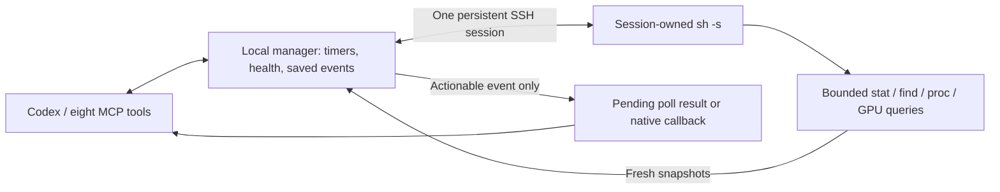
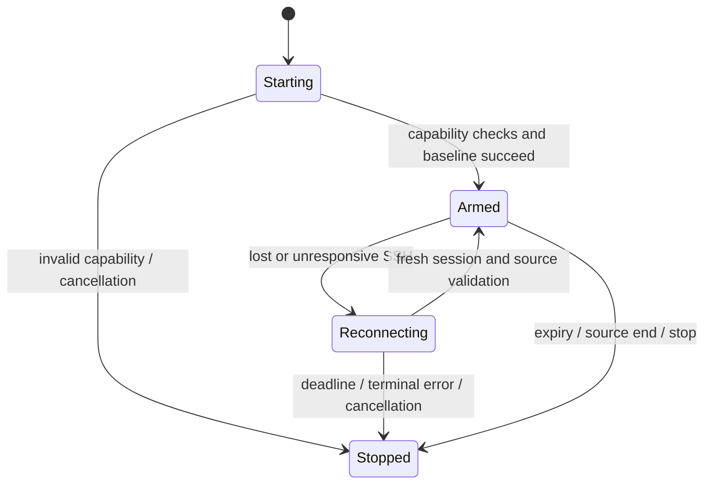

# v0.4.0: persistent SSH monitoring

Status: implemented locally on develop, pending release. Updated 2026-11-07.
Baseline: v0.3.0. Initial target: existing Linux workloads, with Windows and
Linux OpenSSH clients. Development tests do not replace the installed plugin.

## Architecture

The local Node manager schedules bounded read-only queries over one persistent
SSH shell per thread and connection profile. The remote host needs existing
system utilities, not Node, Python, a deployed helper or a daemon. No writable
home, listener, startup registration or training-code modification is required.
SSH still creates processes and normal server audit records.

Transport-only keepalives cannot observe workloads. Opening SSH per sample adds
handshakes. An in-memory Node helper could support richer acquisition, but adds a
runtime requirement and protocol surface. The shell adapter is the implemented
default. There is no automatic runtime installation or durable remote agent.
Connection-only monitors also use this shell, not a separate ssh -N adapter.

## Public contract and modules

Keep the eight tools: start, stop, event, status, validate, display, poll, recovery.
Add optional `transport: {type: "ssh", host: "gpu-box"}`. Remote watchdogs support
files, directories, existing PIDs and GPU thresholds; kind connection observes
connectivity. Remote command ownership is rejected. Remote paths use Linux
semantics even on Windows. Identity/config paths are local.

The [user reference](../../codex-monitor/references/plugin.md#ssh-monitoring)
contains configurations, prerequisites and options. No production dependency is
added. Implementation is split between:

- src/ssh-session.ts: owned OpenSSH process, bounded framing and deadlines.
- src/ssh-samples.ts: normalization, capability checks and snapshot parsing.
- src/ssh-monitor.ts: shared connections, scheduling, health and reconnect.
- src/manager.ts: lifecycle, grouped incidents, waits and delivery.

## Ownership and protocol

One thread shares one connection for an exact host/user/port/identity/config
profile. Conflicting transport policies are rejected. Separate threads do not
share ownership. Stopping the final subscription closes the owned local SSH
process. Independently launched remote jobs are never killed or restarted.

The client uses argument-based process launch, BatchMode, strict host-key checking,
no PTY, no agent/X11/port forwarding, no local command and no ControlMaster socket.
Existing aliases, identity selection and jump-host configuration apply. Resolve
unknown keys and interactive authentication through normal SSH setup.
Foreground execution, readable stdin and a command session are explicit client
options, overriding incompatible profile defaults. Direct and one-hop ProxyJump
paths are covered by Linux container tests.

Each session runs exec sh -s. Only fixed query templates are sent; paths and
executable names use POSIX argument quoting. Each request has a random ID and a
base64 response with an exit-status trailer. NUL-delimited directory records
preserve spaces, quotes and newlines. Invalid UTF-8 filenames fail explicitly.
Unexpected stdout or malformed framing fails the connection. Responses larger
than 512 KiB are discarded through the frame boundary within the request deadline,
failing that source while preserving unrelated subscribers. Diagnostic stderr is bounded.

Queries use remote timeout -k 1 and a separate local deadline. Local timeouts close
observation, but cannot promise immediate termination of a remote process stuck
in kernel I/O. A remote sample timeout is a sensor error; a missing round trip is
a connection incident. Neither proves training died.

## Sampling and health

| Source | Default interval | Evidence |
| --- | --- | --- |
| File / existing PID | 10 seconds | Metadata; boot ID + PID + start time |
| Directory | 30 seconds | Metadata snapshot, optional recursion/filter |
| GPU set | 15 seconds | Existing nvidia-smi output, selected devices only |
| Idle shell heartbeat | 15 seconds | Fresh-nonce request/response |

Scheduling and health evaluation stay local, with one request outstanding per
connection. Compatible GPU samples are briefly cached; cached data never counts
as a new SSH response. Sampling intervals have a one-second minimum. These
defaults are design choices, not measured performance claims.
Gap detection uses the fastest enabled source; a long GPU interval cannot hide
interruption of a faster file/PID watcher. GPU-only sources have no metadata ticks.
Checks run both before and after awaited reads, covering a local process pause
while a query is outstanding. GPU intervals start from completed observations.
File notifications honor per-path debounce without suppressing progress tracking;
deletion clears suppression so a recreated file remains observable.

Directory snapshots have finite time, 4096-entry and response-size bounds. Limits
fail explicitly instead of silently omitting entries. Prefer explicit metrics
files to broad trees. The root may be a directory symlink; nested symlinks are not
followed. An individual watched file must not be a symlink. Changed root identity
requires inspection/rearming. Missing files are supported when their parent exists.

PID identity includes boot ID and /proc start time to detect reuse. Zombie/dead
states count as exited; exit code/time cannot be reconstructed. GPU selection is
validated and excludes unrelated devices from dwell decisions.
Provider commands run in the workload directory; cached GPU snapshots are scoped
to that directory, executable and selectors. Preflight rejects zombie/dead PIDs.

Snapshots may miss transient changes, same-metadata rewrites and brief utilization
spikes. Reconnect or prolonged gaps reset continuous file/GPU dwell and rebaseline
observations. No complete outage history is invented. Sensor errors may stop one
subscription while others continue on a healthy connection.

## Incidents, reconnection and waiting

Loss emits one connection_lost or connection_unresponsive incident with
affected_monitor_ids. It releases a relevant blocking poll or follows existing
callback rules. Evidence includes each affected monitor's instructions. Grouped
incidents survive stopping/muting/replacing one representative monitor and do
not consume workload max_events. Only subscriptions with equal event lifetimes
are grouped; one subscriber cannot shorten another's evidence lifetime.

Retry delays are approximately 5, 15, 30 and then 60 seconds with jitter. The
default incident budget is 30 minutes; monitor lifetimes remain upper bounds.
Host-key/authentication and protocol failures stop retries. New subscriptions
are rejected while the target reconnects. During an outage workload health is
unknown, not stalled/exited; reports distinguish reconnecting from running.
The incident deadline also bounds an in-flight reconnect handshake. New observers
have a separate readiness deadline. Cancellation or caller disconnection while
registration is queued/preparing prevents late attachment. A lost connection
fails unready subscriptions promptly while existing observers can reconnect.

After reconnect, revalidate sources and resume observation immediately. Emit
connection_restored only after 60 seconds of stability. Earlier flaps retain the
same incident and original deadline. A healthy connection does not fail solely
because stability testing exceeds a shorter reconnect budget. Stopped/muted
subscriptions are never silently rearmed.
File/GPU dwell restarts after the fresh baseline has been acquired, so time spent
obtaining that baseline cannot immediately count as a training stall.

Existing acknowledgement, finite poll, CLI input wake and native goal ownership
rules remain. Waiting during reconnect requires handled prior events and live
reconnect/error/expiry guards. SSH reconnect is independent of the five-minute
Codex failed-turn recovery policy.
Stopping one observer releases its dependent wait for reassessment while leaving
other observers' notifications intact. Cancelled or muted recipients have no
actionable instructions in a shared event. The final SSH observer keeps its
capacity slot until owned connection cleanup has completed.

## Validation and limits

tests/node/ssh.test.mjs covers normalization, quoting, framing, metadata, GPU
selection/dwell, real persistent sessions, host trust, Docker pause/unpause,
bounded reconnect, stable restoration, shared incident routing and cancellation.
Real SSH cases require CODEX_MONITOR_TEST_SSH=1 and the server fixture image.

node tools/test-ssh-linux.mjs builds a Linux client, target and jump server on an
internal Docker network. The target has no Node/Python and its user's home is
read-only. Direct and ProxyJump cases check persistence, shared subscriptions,
special paths, conflicting client profile settings and cleanup. The SSH
CI job runs these fixtures. Tests/workflows are excluded from deployment packages.

Local candidate validation on 2026-11-07:

| Run | Result |
| --- | --- |
| Windows full native + real SSH suite, after review | 286 passed, 9 skipped, 0 failed |
| Ubuntu 24.04 full native suite, non-root, external network disabled, after review | 280 passed, 15 skipped, 0 failed |
| Internal-network Linux SSH fixtures, direct and ProxyJump | 2 passed |
| Focused SSH review regressions (included above) | 15 passed |
| Shared-wait stop isolation, blocking and pause/re-wait (included above) | 2 passed |
| Dispatch, history and recovery regressions (included above) | 14 passed |
| Follow-up recovery ordering/cadence regressions (included above) | 2 passed |
| Deployment package with production-only dependencies | 8 MCP tools and isolated execution verified |
| [Cross-platform CI](https://github.com/EthenJ/codex-monitor/actions/runs/42267525982) | All 19 jobs passed; Windows Node 24 passed on rerun |

Skips cover platform/environment-specific cases, including real NVIDIA hardware;
the full Ubuntu suite skips the Docker-host SSH cases exercised separately.
Container fixtures do not establish
compatibility with every SSH server, startup file or proxy/jump-host chain.
GPU behavior is tested with controlled provider output, not real NVIDIA hardware.
See the [review record](v0.4.0-review.md) for corrected defects and remaining
validation boundaries.

## Protocol references

- [OpenSSH client options and remote commands](https://man.openbsd.org/ssh.1)
- [OpenSSH configuration](https://man.openbsd.org/ssh_config.5)
- [Linux proc filesystem](https://docs.kernel.org/filesystems/proc.html)
